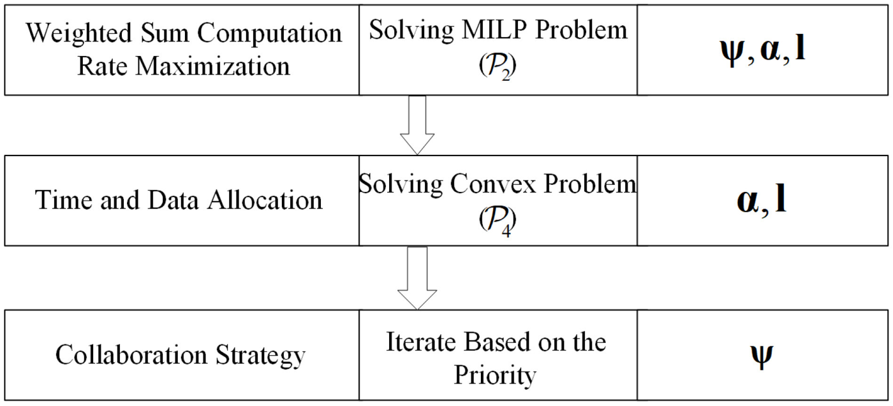
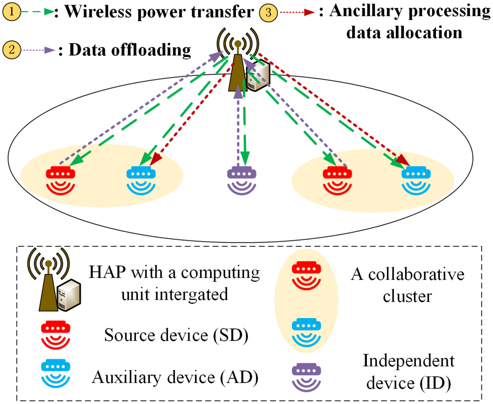
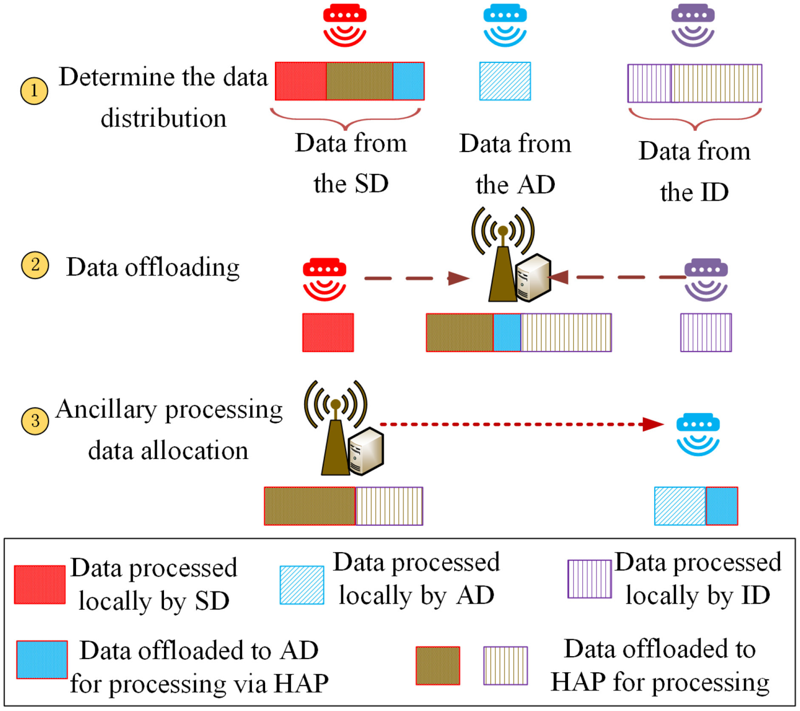
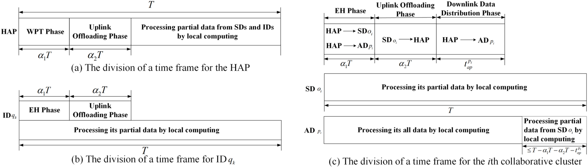

<<<<<<< HEAD
<div align="center">

# Computation Rate Maximization for Wireless-Powered Edge Computing<br>With Multi-User Cooperation

**Yang Li**<sup>1</sup> &nbsp;
**Xing Zhang**<sup>1</sup> &nbsp;
**Bo Lei**<sup>2</sup> &nbsp;
**Qianying Zhao**<sup>2</sup> &nbsp;
**Min Wei**<sup>2</sup> &nbsp;
**Zheyan Qu**<sup>1</sup> &nbsp;
**Wenbo Wang**<sup>1</sup>

<sup>1</sup>School of Information and Communication Engineering, Beijing University of Posts and Telecommunications, Beijing, China<br>
<sup>2</sup>Network Technology Department of China Telecom Research Institute, Beijing Branch of China Telecom Company Ltd., Beijing, China


</div>

<p align="center">
  
</p>

<p align="center"><em>
The two-level optimization structure. Given a collaboration strategy, the inner level solves the time and data allocation sub-problem with an interior-point method based algorithm. The outer level searches for the collaboration strategy, where a priority-based iterative algorithm or a deep learning based predictor determines the collaborative clusters.
</em></p>

## Highlights

Wireless-powered mobile edge computing (WP-MEC) combines RF-based wireless power transfer (WPT) with MEC, providing sustainable energy supply and computing services at the network edge for industrial IoT systems. Prior multi-user designs either fix the collaborative relationships among users or only consider two-user cooperation, failing to exploit the system's computational capacity as the network state changes. This work proposes a **dynamic multi-user cooperation scheme** where collaborative clusters are formed on the fly, and jointly optimizes the collaboration strategy, time allocation, and data assignment.

- **Dynamic multi-user collaboration.** Devices are classified into source devices (SDs), auxiliary devices (ADs), and independent devices (IDs). Each collaborative cluster comprises an SD and an AD, and clusters are re-formed every time frame according to data importance, channel quality, and computational capacity.
- **Joint optimization of collaboration, time, and data allocation.** The weighted sum computation rate (WSCR) maximization problem is formulated as a mixed-integer program under energy causality and minimum data processing requirements, and proven NP-hard.
- **Three-layer solution approach.** An interior-point method based algorithm solves the convex time and data allocation sub-problem; a priority-based iterative algorithm searches the collaboration strategy in a reduced space; a deep learning based algorithm further predicts the optimal number of collaborative clusters, cutting the runtime complexity from $O(LN^4)$ to $O(LN^3)$.
- **Near-optimal performance with drastic runtime reduction.** Both proposed algorithms approach the exhaustive search performance, while the DL-based algorithm keeps its execution time nearly flat as the number of devices grows.

## System scenario

<p align="center">
  
</p>

<p align="center"><em>
The wireless-powered MEC network. A hybrid access point (HAP) equipped with a computing unit, an RF energy transmitter, and multiple antennas serves $N$ single-antenna IoT devices. Each device harvests RF energy from the HAP and offloads part of its data for edge processing.
</em></p>

At the beginning of each time frame, the $N$ devices are categorized into three types:

- **Source devices (SDs)**, whose task data is partitioned into three parts: processed locally, offloaded to the HAP, and remotely executed by a paired **AD** (forwarded through the HAP to avoid distance limitations).
- **Auxiliary devices (ADs)**, each paired with an SD to form a collaborative cluster; an AD processes its own data locally and assists its paired SD.
- **Independent devices (IDs)**, which do not cooperate and split their data between local computing and HAP offloading.

<p align="center">
  
</p>

<p align="center"><em>
Data allocation for the three device types. The SD $o_i$ splits its data into local processing, HAP processing, and AD $p_i$ processing; the AD processes its own data locally plus a segment from its SD; the ID splits its data between local and HAP processing.
</em></p>

### Harvest-and-offload protocol

<p align="center">
  
</p>

<p align="center"><em>
The harvest-and-offloading protocol with user cooperation (UC) and OFDMA. Each time frame consists of WPT, uplink offloading, and HAP processing / forwarding stages, with TDD on sub-channels letting energy harvesting and data transmission share the same band.
</em></p>

The time block is organized into three stages:

1. **WPT stage** ($\alpha_1 T$): the HAP broadcasts wireless power. The energy harvested by device $n$ is $E_n^h=\min(\eta P h_n \alpha_1 T,\ E_n^{max})$, where $\eta$ is the harvesting efficiency and $h_n$ the channel gain.
2. **Offloading stage** ($\alpha_2 T$): devices offload the data intended for the HAP and for their paired ADs over orthogonal sub-channels.
3. **Processing stage** (remaining $T-(\alpha_1+\alpha_2)T$): the HAP computes the offloaded workload and forwards each SD's auxiliary segment to the corresponding AD, which must finish both local and auxiliary processing before the frame ends.

Every device obeys **energy causality** (it cannot consume more than the harvested energy) and a **minimum data processing requirement** $l_{th}$ per frame.

## Problem formulation

The goal is to maximize the weighted sum computation rate of the network by jointly optimizing the collaboration strategy $\psi=\{m,\mathcal{O},\mathcal{P},\mathcal{Q}\}$, the time allocation $\boldsymbol{\alpha}=(\alpha_1,\alpha_2)$, and the data allocation $\mathbf{l}$:

$$
\max_{\psi,\boldsymbol{\alpha},\mathbf{l}}
\sum_{i=1}^{m}
\left(
w_{o_i}\left(l_{o_i}^{loc}+l_{o_i}^{ap}+l_{o_i}^{p_i}\right)
+w_{p_i}l_{p_i}^{loc}
\right)
+\sum_{k=1}^{N-2m}
w_{q_k}\left(l_{q_k}^{loc}+l_{q_k}^{ap}\right)
$$

subject to

- **cluster formation**: each SD pairs with a unique AD, $|\mathcal{O}|=|\mathcal{P}|=m\in\{0,\dots,\lfloor N/2\rfloor\}$;
- **time constraints**: offloading, HAP processing, and AD-assisted processing must all fit into their respective stages;
- **energy causality**: local computing plus offloading energy cannot exceed the harvested energy for every device;
- **minimum data requirement**: each device processes at least $l_{th}$ bits per frame.

The problem is a mixed-integer program and is proven **NP-hard** (a special case reduces to a mixed-integer linear program).

## How it works

### Algorithm 1: interior-point method for time and data allocation

Given a fixed collaboration strategy, the remaining problem is linear in $\{\boldsymbol{\alpha},\mathbf{l}\}$ and hence convex. After transforming it into standard form and introducing a logarithmic barrier, the Karush–Kuhn–Tucker conditions yield a nonlinear system solved by Newton iterations, with the barrier parameter $\mu$ decreased progressively. This yields the optimal time and data allocation with complexity $O(LN^3)$ per strategy, where $L$ is the iteration count.

### Algorithm 2: priority-based iterative search for collaboration strategy

Exhaustively enumerating all cluster formations costs $O\big(LN^3\big(1+\sum_{m=1}^{\lfloor N/2\rfloor}C_N^{2m}(2m-1)!!\big)\big)$. Instead, a priority score guides cluster formation:

$$
O_n=\frac{w_n B\log_2\!\big(1+\frac{p_n h_n}{N_0}\big)}{k_n f_n^2\varphi_n p_n},
$$

which rewards devices whose data is important, whose channel is good, and whose local computing is expensive — i.e., devices that benefit most from offloading serve as **SDs**, while devices with the lowest priority serve as **ADs**. Starting from $m=0$ (all IDs), each iteration adds one cluster by pairing the highest-priority ID with the lowest-priority ID, evaluates the achievable WSCR via Algorithm 1, and finally keeps the best $m^\ast$. Overall complexity: $O(LN^4)$.

### Algorithm 3: deep learning accelerated decision

To skip the iterative search over the number of clusters, a DNN is trained to map the system state $(\mathbf{w},\mathbf{h})$ directly to the optimal number of clusters $m^\ast$:

- collect state samples $\{\mathbf{w}^t,\mathbf{h}^t\}$ and label them with Algorithm 2;
- train a DNN (input dimension $2N$, output $m^\ast$) with cross-entropy loss on standardized data;
- at decision time, the HAP feeds the current state into the trained model and only Algorithm 1 is executed once — reducing the complexity to $O(LN^3)$.

| Scheme | Complexity |
|---|---|
| Exhaustive search (EX) | $O\big(LN^3\big(1+\sum_{m=1}^{\lfloor N/2\rfloor}C_N^{2m}(2m-1)!!\big)\big)$ |
| Priority-based iterative (PI) | $O(LN^4)$ |
| **DL-based (DL)** | $O(LN^3)$ |

## Experimental results


### Key findings

- **Near-optimality.** The WSCR achieved by the priority-based iterative algorithm and the DL-based algorithm closely matches the exhaustive search for all tested average distances and minimum data requirements, showing both converge towards the global optimum.
- **Runtime scaling.** For small networks (e.g., $N=5$), PI and DL have comparable execution time. As $N$ grows, PI's runtime rises sharply because of the iterative cluster-count search, whereas DL stays nearly flat — PI suits small networks, DL suits large ones, consistent with the complexity analysis.
- **Comparison with baselines.** Against local-computing-only (LC), non-collaborative partial offloading (NC), and stochastic collaboration (SC), both proposed schemes achieve the highest WSCR, and the gap over NC **widens** as $N$ increases: optimizing collaboration matters most in large-scale networks. Poorly designed collaboration (SC) even underperforms no collaboration (NC).
- **When collaboration pays off.** Collaboration is most valuable when the HAP's computing speed $f^{ap}$ is limited and the channel quality is good; when $f^{ap}>1$ GHz or the path loss exponent $d_e\geq 2.8$, NC approaches the proposed schemes and user collaboration becomes unnecessary.
- **Optimal cluster count.** The optimal number of collaborative clusters $m^\ast$ increases with the harvesting efficiency $\eta$ and the device number $N$, and decreases with $f^{ap}$ and $l_{th}$: collaboration is encouraged when the bottleneck is HAP computing capacity, and restrained when energy is scarce.

## Repository structure

```
WPMEC-Coop/
├── README.md                 # this file
├── wpmec_env.py              # system simulation: network model, energy harvesting, protocol, constraints
├── interior_point.py         # Algorithm 1: interior-point method for time & data allocation (P4)
├── priority_search.py        # Algorithm 2: priority-based iterative collaboration strategy search
├── dnn.py                    # Algorithm 3: DNN model for predicting the optimal cluster number
├── train_dnn.py              # dataset generation (via Algorithm 2) and DNN training
├── main.py                   # entry point: runs EX / PI / DL / LC / NC / SC comparisons
└── assets/                   # figures
```

## Acknowledgment

This work was supported by the National Science Foundation of China under Grant **62071063** and Grant **62271062**.

## Citation

If you find this work useful, please cite:

```bibtex
@article{li2024computation,
  title   = {Computation Rate Maximization for Wireless-Powered Edge Computing With Multi-User Cooperation},
  author  = {Li, Yang and Zhang, Xing and Lei, Bo and Zhao, Qianying and Wei, Min and Qu, Zheyan and Wang, Wenbo},
  journal = {IEEE Open Journal of the Communications Society},
  volume  = {5},
  pages   = {965--981},
  year    = {2024},
  doi     = {10.1109/OJCOMS.2024.3358064}
}
```

## Contact

For questions about this work, please contact please contact the first author Yang Li (ylibupt@163.com), or the corresponding author **Xing Zhang** (zhangx@ieee.org).

